<p align="center">
  
</p>

<h1 align="center">ÁKRON — Sistema de Monitoramento Industrial</h1>

<p align="center"><em>Visão de ponta a ponta para sua operação.</em></p>

Sistema web em **PHP + MySQL** para acompanhar sensores de uma planta industrial:
painel com os números do dia, gráficos de leituras em tempo real, alertas por
severidade, relatório de qualidade ambiental e gestão de sensores e usuários.
Tem **tema claro e escuro** e uma **API JSON** que alimenta o aplicativo móvel
(repositório [`app_tcc`](https://github.com/Nananilda/app_tcc), em Flutter).

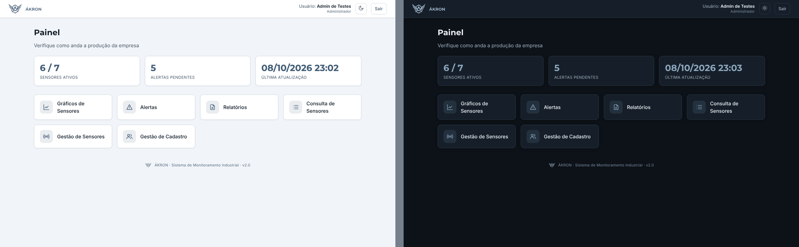

---

## Sumário

1. [Telas](#telas)
2. [Como instalar e rodar](#como-instalar-e-rodar)
3. [Contas de teste](#contas-de-teste)
4. [Alertas: manuais e automáticos](#alertas-manuais-e-automáticos)
5. [Estrutura do projeto](#estrutura-do-projeto)
6. [Padrão de nomes](#padrão-de-nomes)
7. [Tema claro e escuro](#tema-claro-e-escuro)
8. [Identidade visual](#identidade-visual)
9. [Banco de dados](#banco-de-dados)
10. [API do aplicativo](#api-do-aplicativo)
11. [Segurança](#segurança)
12. [Testes](#testes)
13. [Limitações conhecidas e próximos passos](#limitações-conhecidas-e-próximos-passos)
14. [Licenças de terceiros](#licenças-de-terceiros)

---

## Telas

Cada imagem mostra o **tema claro** (esquerda) e o **tema escuro** (direita).

| Tela | Captura |
|------|---------|
| Login | 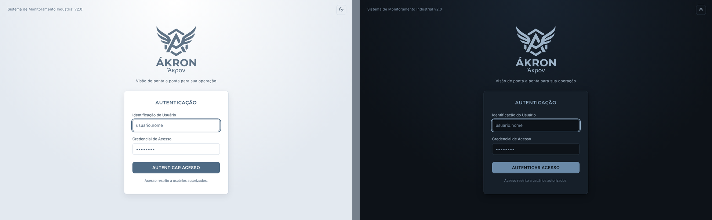 |
| Painel (administrador) |  |
| Gráficos de sensores (atualização a cada 15 s) | 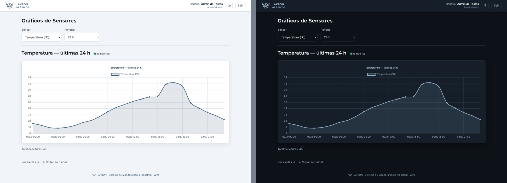 |
| Alertas (com o botão **Adicionar alerta**, para administradores) | 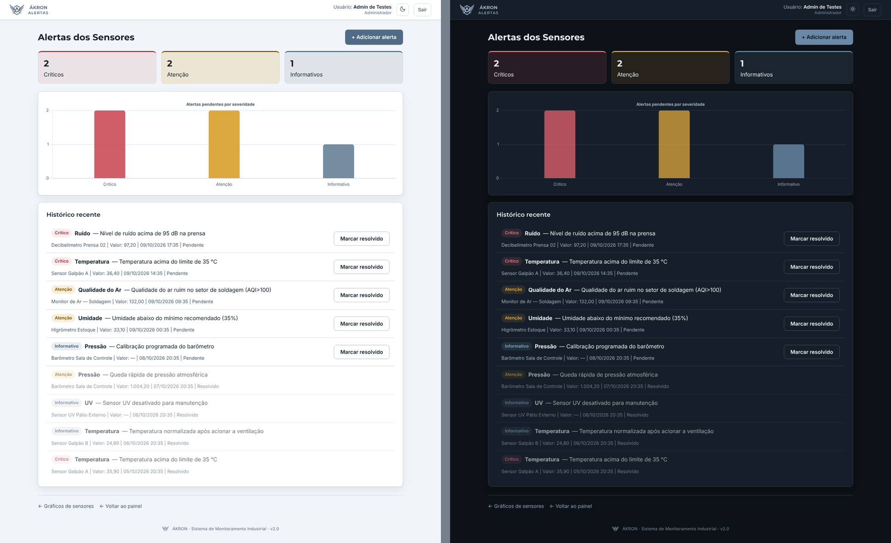 |
| Novo alerta: manual, leitura de teste e limites automáticos (administrador) | 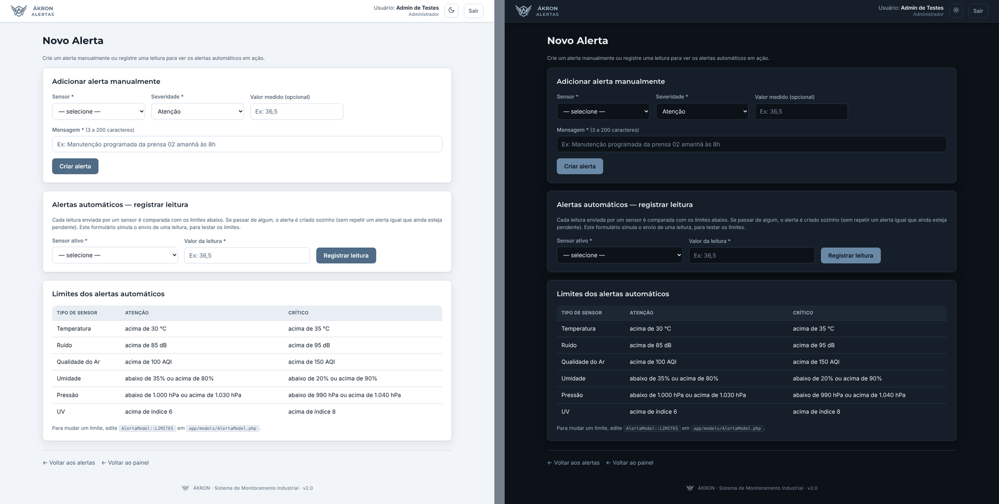 |
| Relatório de qualidade ambiental | 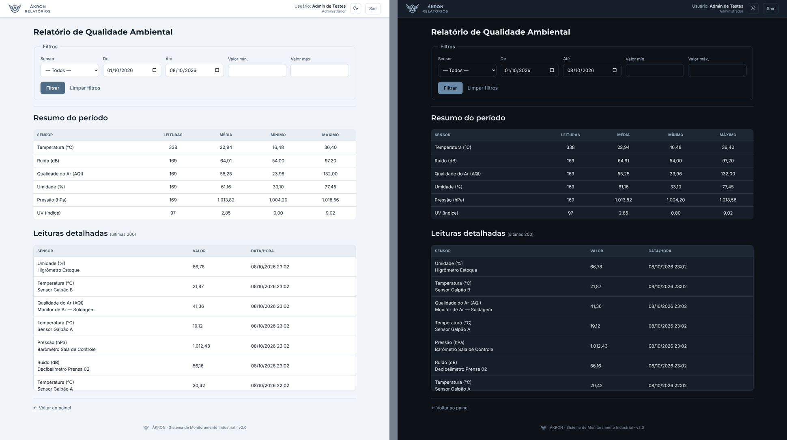 |
| Consulta de sensores (somente leitura) | 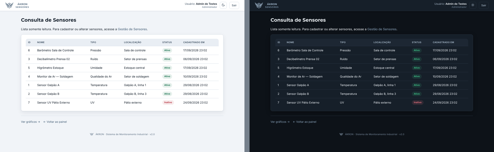 |
| Gestão de sensores (administrador) | 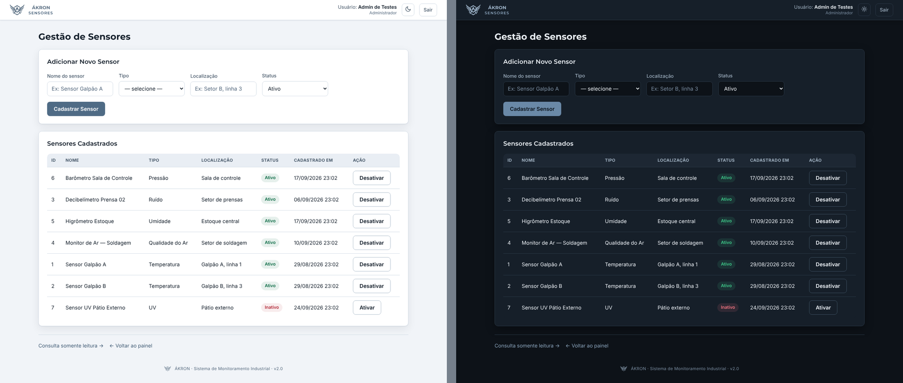 |
| Gestão de usuários | 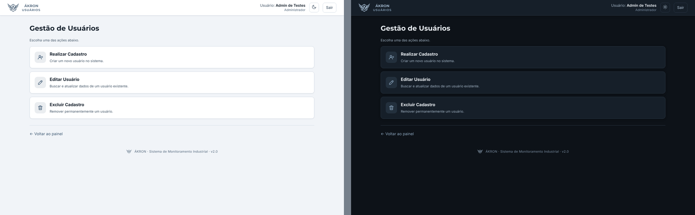 |
| Cadastro de usuário | 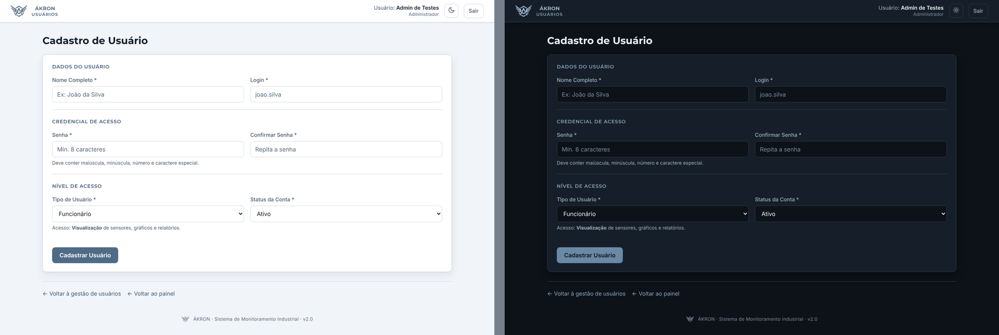 |
| Editar usuário | 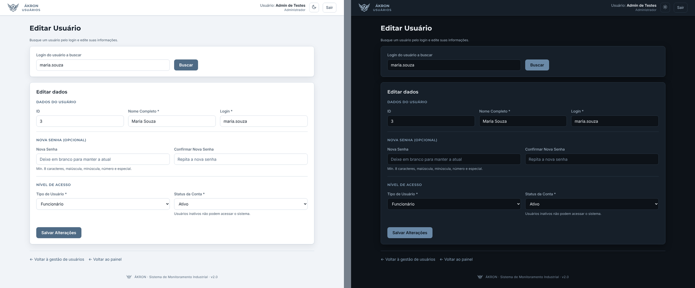 |
| Excluir usuário (confirmação em duas etapas) | 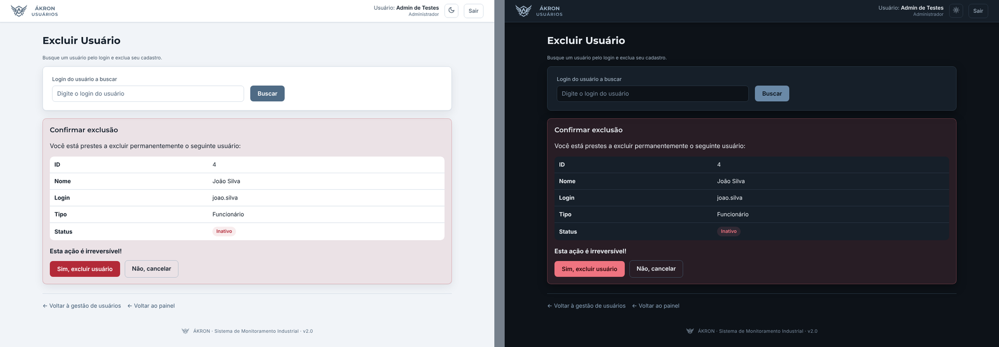 |
| Painel do funcionário (sem as áreas de administração) | 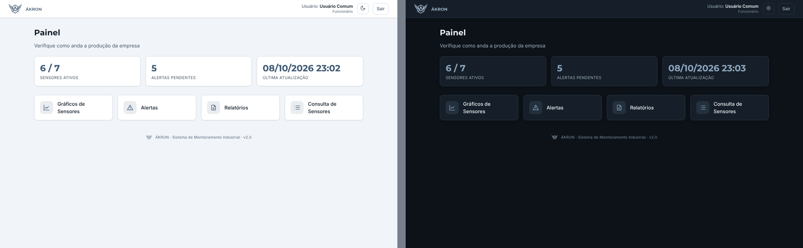 |

Todas as telas se adaptam ao celular (veja as capturas em
[`docs/capturas/celular`](docs/capturas/celular)).

---

## Como instalar e rodar

### Requisitos

- **PHP 8.1 ou mais novo** com a extensão `pdo_mysql` (e, de preferência, `mbstring`)
- **MySQL 5.7+ ou MariaDB 10.3+**
- Apache (XAMPP/WAMP) **ou** o servidor embutido do PHP (`php -S`)

### Passo a passo

1. **Copie o projeto** para a pasta do servidor, por exemplo `C:\xampp\htdocs\tcc`
   (qualquer nome de pasta funciona: o endereço-base é detectado sozinho).

2. **Crie o banco de dados.** Pelo terminal (ajuste usuário/senha):

   ```bash
   mysql -u root -p < sql/schema.sql            # cria o banco "banco_tcc" e o usuário admin
   mysql -u root -p banco_tcc < sql/dados_exemplo.sql   # (opcional) sensores, 7 dias de leituras e alertas
   ```

   > ⚠ `schema.sql` **apaga e recria** o banco `banco_tcc`. Use só na instalação
   > inicial ou para zerar o ambiente de testes.

3. **Informe os dados de conexão** (sem editar código e sem mandar senha para o Git).
   Escolha uma das opções:

   - copie `app/config/conexao.local.exemplo.php` para `app/config/conexao.local.php`
     e edite host, porta, usuário e senha (esse arquivo é ignorado pelo Git); **ou**
   - defina variáveis de ambiente: `AKRON_DB_HOST`, `AKRON_DB_PORT`, `AKRON_DB_NAME`,
     `AKRON_DB_USER`, `AKRON_DB_PASS`.

   Os valores padrão (`localhost`, `3306`, `banco_tcc`, `root`, senha `123456`) são
   os do ambiente de desenvolvimento original. No XAMPP, o `root` costuma ter senha vazia.

4. **Abra no navegador:**

   - Apache/XAMPP: `http://localhost/tcc/`
   - Sem Apache, na raiz do projeto: `php -S 127.0.0.1:8000` → `http://127.0.0.1:8000/`

Se o banco estiver fora do ar, o sistema mostra uma página explicando o que conferir
(os detalhes técnicos ficam só no log do servidor).

### Outras configurações (opcionais)

| Variável de ambiente | Para que serve | Padrão |
|----------------------|----------------|--------|
| `AKRON_TIMEZONE` | Fuso horário do PHP **e** da sessão do MySQL | `America/Sao_Paulo` |
| `AKRON_BASE_URL` | Pasta de instalação, se a detecção automática não servir | detectada |

---

## Contas de teste

Criadas por `schema.sql` (admin) e `dados_exemplo.sql` (demais).

| Login | Senha | Perfil | Observação |
|-------|-------|--------|------------|
| `admin` | `Admin@123` | Administrador | acesso total — **troque a senha** em *Gestão de Cadastro → Editar Usuário* |
| `usuario` | `Usuario@123` | Funcionário | só consulta |
| `maria.souza` | `Usuario@123` | Funcionário | só consulta |
| `joao.silva` | `Usuario@123` | Funcionário | conta **inativa** (serve para testar o bloqueio) |

**Administrador** vê e gerencia tudo (inclusive adiciona e resolve alertas). **Funcionário** consulta painel, gráficos, alertas,
relatórios e a lista de sensores; não vê a gestão de sensores nem a de usuários (e,
se digitar o endereço, recebe a página de acesso negado).

---

## Alertas: manuais e automáticos

Um alerta pode nascer de duas formas:

1. **Manual** — o administrador clica em **+ Adicionar alerta** (tela *Alertas*), escolhe o
   sensor, a severidade (informativo, atenção ou crítico), escreve a mensagem e, se quiser,
   o valor medido. Serve para manutenção programada, avisos da equipe, ocorrências observadas…
2. **Automática, por limites** — toda vez que uma **leitura** é registrada, o valor é comparado
   com os limites do tipo do sensor. Se passar, o alerta é criado sozinho, com a severidade
   correspondente e o valor medido. Enquanto houver um alerta **igual e ainda pendente** para o
   mesmo sensor, nenhum duplicado é criado (um sensor que continua quente não gera um alerta a
   cada leitura); depois que o administrador o resolve, a próxima leitura fora do limite gera outro.

Limites em vigor (ficam em `AlertaModel::LIMITES`, em `app/models/AlertaModel.php` — basta
mudar o número para ajustar; a tela *Novo alerta* e o aplicativo mostram a tabela atualizada):

| Sensor | Atenção | Crítico |
|--------|---------|---------|
| Temperatura | acima de 30 °C | acima de 35 °C |
| Ruído | acima de 85 dB | acima de 95 dB |
| Qualidade do ar | acima de 100 AQI | acima de 150 AQI |
| Umidade | abaixo de 35% ou acima de 80% | abaixo de 20% ou acima de 90% |
| Pressão | abaixo de 1.000 hPa ou acima de 1.030 hPa | abaixo de 990 hPa ou acima de 1.040 hPa |
| UV | acima de índice 6 | acima de índice 8 |

**Como as leituras chegam?** Por `POST api/leituras.php` com `{"sensor_id": 1, "valor": 36.5}`
(só sensores **ativos**):

- por um **administrador logado** (token `Bearer`) — é o que a tela *Novo alerta → Registrar
  leitura* e o aplicativo fazem, para testar e demonstrar;
- por um **sensor/gateway** (ESP32, Arduino, CLP…) sem conta de usuário, enviando a chave no
  cabeçalho `X-Chave-Sensor`. A chave (mín. 16 caracteres) é definida na variável de ambiente
  `AKRON_CHAVE_SENSORES` ou em `app/config/conexao.local.php` (`'chave_sensores' => '…'`).
  Sem chave configurada, esse caminho fica **desligado**. A chave só vale para `leituras.php`.

```bash
curl -s -X POST http://localhost/tcc/api/leituras.php \
     -H "Content-Type: application/json" -H "X-Chave-Sensor: SUA-CHAVE-COM-16-OU-MAIS-CARACTERES" \
     -d '{"sensor_id": 1, "valor": 36.5}'
# → {"sucesso":true,"mensagem":"Leitura registrada. Alerta crítico gerado automaticamente: …","alerta":{…}}
```

Os dados de demonstração (`sql/dados_exemplo.sql`) são fixos: os 9 alertas de exemplo foram
inseridos à mão no script, não gerados pelos limites.

---

## Estrutura do projeto

```
tcc/
├── index.php                  Tela de login
├── api/                       API JSON usada pelo aplicativo (veja "API do aplicativo")
├── app/
│   ├── config/
│   │   ├── app.php            Nome do sistema, fuso horário, BASE_URL e helpers (urlApp, escapar…)
│   │   ├── conexao.php        Conexão PDO com o MySQL (variáveis de ambiente / arquivo local)
│   │   └── conexao.local.exemplo.php
│   ├── models/                Acesso ao banco: SQL de cada entidade (*Model.php)
│   ├── controllers/           Regras de negócio e validações (*Controller.php) — usadas pelas telas e pela API
│   └── views/                 Telas (HTML + PHP), organizadas por assunto
│       ├── partials/          Pedaços reutilizados: cabeçalho, rodapé, <head>, ícones
│       ├── dashboard/  graficos/  (gráficos, alertas, novo alerta)  relatorios/  sensores/  usuarios/
│       └── 403.php            Página de acesso negado
├── includes/auth.php          Sessão, login, CSRF, permissões (exigirLogin / exigirAdmin)
├── routes/                    Ações sem tela: logout e dados do gráfico em tempo real (AJAX)
├── public/assets/
│   ├── css/                   style.css (tokens de cor dos dois temas) + um CSS por tela
│   ├── js/                    tema.js, graficos.js e vendor/chart.umd.js (Chart.js)
│   ├── img/                   Logos ÁKRON (SVG), favicons e ícone do iPhone
│   └── fonts/                 Inter e Montserrat (arquivos locais — funciona sem internet)
├── sql/                       schema.sql (estrutura) e dados_exemplo.sql (demonstração)
├── tests/api_test.py          Teste de integração da API (101 verificações)
└── docs/                      Logo em alta resolução e capturas de tela
```

**Fluxo de uma tela:** a *view* chama um *controller*, que valida os dados e usa um
*model* para falar com o banco. A mesma regra serve ao site e ao aplicativo — por
exemplo, `UsuarioController` é usado por `app/views/usuarios/*.php` **e** por `api/usuarios.php`.

---

## Padrão de nomes

| Elemento | Convenção | Exemplos |
|----------|-----------|----------|
| Classes | `PascalCase` + sufixo do papel | `SensorModel`, `UsuarioController` |
| Funções e métodos | `camelCase`, verbo no infinitivo, em português | `listarTodos()`, `buscarPorLogin()`, `exigirAdmin()` |
| Variáveis | `camelCase` | `$usuarioEncontrado`, `$sensores` |
| Constantes | `MAIÚSCULAS_COM_SUBLINHADO` | `APP_NOME`, `BASE_URL`, `SensorModel::TIPOS` |
| Telas (views) e rotas | `minúsculas_com_sublinhado.php` | `gestao_usuarios.php`, `grafico_dados.php` |
| Tabelas e colunas | `minúsculas_com_sublinhado` | `leitura_sensor`, `resolvido_por` |
| CSS e JS | `minúsculas`, um arquivo por tela | `usuarios.css`, `graficos.js` |
| Textos de tela | sempre pelas constantes de `app/config/app.php` | `APP_NOME` → "ÁKRON" |

O que foi corrigido em relação à versão anterior:

| Antes | Depois | Por quê |
|-------|--------|---------|
| `DashbordController.php` | `DashboardController.php` | erro de digitação |
| `models/Alerta.php`, `Sensor.php`, `Usuario.php`, `Relatorio.php` | `AlertaModel.php`, `SensorModel.php`, `UsuarioModel.php`, `RelatorioModel.php` (+ novo `LeituraModel.php`) | o sufixo deixa claro o que é *Model* e o que é *Controller* |
| `public/assets/js/chart.js` | `graficos.js` | o nome se confundia com a biblioteca Chart.js (agora em `js/vendor/`) |
| `logo.svg`, `logo-full.svg` | `akron-simbolo.svg`, `akron-nome.svg`, `akron-logo-completa.svg` | identidade ÁKRON |
| `models/DadosExemplo.php` | `sql/dados_exemplo.sql` | dados de demonstração agora são um script SQL, fora do código |
| Nome do sistema escrito à mão em cada tela (inclusive "IndustrialOS") | constantes `APP_NOME`, `APP_DESCRICAO`, `APP_LEMA` | muda em um lugar só |
| Tipos de sensor repetidos em vários arquivos | `SensorModel::TIPOS` | fonte única de nomes, unidades e rótulos |

> As **tabelas** do banco mantêm os nomes originais (`usuario`, `sensores`,
> `leitura_sensor`, `alertas`) para não quebrar bancos já existentes. Se quiser
> padronizar tudo no plural, é uma troca simples (schema + models) — veja
> [próximos passos](#limitações-conhecidas-e-próximos-passos).

---

## Tema claro e escuro

- A cor de **tudo** vem de variáveis CSS definidas em `public/assets/css/style.css`.
  O tema é escolhido pelo atributo `data-tema="claro|escuro"` na tag `<html>`.
- O botão de sol/lua na barra superior alterna o tema. A escolha fica no
  `localStorage` (`akron-tema`); enquanto a pessoa não escolher, vale a preferência
  do sistema operacional e o site acompanha quando ela muda.
- `tema.js` é carregado no `<head>`, **sem `defer`**, de propósito: o tema é aplicado
  antes da primeira pintura e a página não "pisca" no tema errado.
- Os gráficos (Chart.js) leem as cores das variáveis `--cor-grafico-*` e **se
  recolorem na hora** quando o tema muda (evento `akron:tema`).
- As cores dos dois temas foram conferidas contra o critério de contraste **WCAG AA**
  (texto ≥ 4,5:1; logo ≥ 3:1).
- Para mudar a paleta, edite só os blocos `:root` e `:root[data-tema="escuro"]` de `style.css`.

---

## Identidade visual

- **Logo** (símbolo, nome e versão completa): `public/assets/img/akron-*.svg`. São usados
  como *máscara* CSS (`.logo-simbolo`, `.logo-nome`, `.logo-completa`), então
  assumem a cor da marca do tema ativo (azul-ardósia no claro, azul-ardósia claro no escuro).
- **Favicon** e ícone do iPhone: `favicon.svg`, `favicon.ico`, `favicon-32.png`, `apple-touch-icon.png`.
- **Fontes:** Montserrat nos títulos e Inter no texto, hospedadas em `public/assets/fonts/`.
- A arte original em alta resolução está em `docs/identidade/`.

---

## Banco de dados

Banco `banco_tcc` (utf8mb4), criado por `sql/schema.sql`:

| Tabela | Conteúdo |
|--------|----------|
| `usuario` | contas (nome, login único, senha em **hash bcrypt**, perfil `admin`/`usuario`, status `ativo`/`inativo`; a coluna `criado_em` é opcional — o sistema funciona com ou sem ela) |
| `sensores` | sensores da planta (nome, tipo, localização, status) |
| `leitura_sensor` | uma linha por medição (`sensor_id`, `valor`, `lido_em`) — chave estrangeira para `sensores` |
| `alertas` | ocorrências por severidade (`info`/`atencao`/`critico`), com quem resolveu (`resolvido_por`) |

Os tipos de sensor são `temperatura`, `ruido`, `qualidade_ar`, `umidade`, `pressao` e `uv`.

> **Banco já criado com a versão antiga do `schema.sql`?** Aquela tabela `usuario` não tinha a
> coluna `criado_em`. O sistema **não depende mais dela** (cadastrar, editar e excluir usuários
> funcionam nos dois formatos), então não é preciso recriar o banco.

`sql/dados_exemplo.sql` gera 7 sensores, cerca de 1.100 leituras (**uma por hora, nos últimos
7 dias**) e 9 alertas. As datas são relativas a `NOW()`: rode o script de novo antes de uma
apresentação para "atualizar" os dados.

---

## API do aplicativo

Base: `http://SEU-SERVIDOR/tcc/api/` — respostas em JSON (UTF-8).

**Autenticação:** `POST login.php` devolve um `token`; envie-o nas chamadas seguintes no
cabeçalho `Authorization: Bearer <token>`. (Cookies não são usados: assim a API funciona
em Android, iOS, desktop e também no Flutter Web.) A cada chamada o servidor confere de novo
a conta no banco: se ela foi excluída, inativada ou rebaixada, isso vale na hora.
Sessões expiram em 2 horas.

| Método e endpoint | Quem pode | O que faz |
|-------------------|-----------|-----------|
| `GET status.php` | todos | verifica se o servidor e o banco respondem |
| `POST login.php` `{login, senha}` | todos | autentica; devolve `usuario` e `token` |
| `POST logout.php` | logado | encerra a sessão do token |
| `GET dashboard.php` | logado | números do painel (sensores ativos, alertas pendentes…) |
| `GET sensores.php` | logado | lista de sensores |
| `POST sensores.php` `{acao: "cadastrar" \| "toggle_status", …}` | **admin** | cadastra / ativa / desativa sensor |
| `GET alertas.php` | logado | alertas recentes + contagem de pendentes por severidade + `limites` dos alertas automáticos |
| `POST alertas.php` `{acao: "resolver", alerta_id}` | **admin** | marca alerta como resolvido |
| `POST alertas.php` `{acao: "criar", sensor_id, severidade, mensagem, valor?}` | **admin** | cria um alerta manualmente |
| `GET leituras.php?sensor=&horas=` | logado | série de leituras (6, 12, 24, 48 ou 168 h) |
| `POST leituras.php` `{sensor_id, valor}` | **admin** ou sensor com `X-Chave-Sensor` | registra uma leitura e gera o alerta automático, se passar de um limite |
| `GET relatorio.php?data_ini=&data_fim=&sensor=&val_min=&val_max=` | logado | leituras (até 200) + resumo estatístico |
| `GET usuarios.php[?login=]` | **admin** | lista ou busca usuário por login |
| `POST usuarios.php` `{acao: "cadastrar" \| "atualizar" \| "excluir", …}` | **admin** | gestão de usuários |

Respostas de erro têm a forma `{ "sucesso": false, "mensagem": "…", "erros": ["…"] }`, com o
código HTTP adequado (401 sem sessão, 403 sem permissão, 422 dados inválidos, 503 banco fora do ar).
Exemplo:

```bash
curl -s -X POST http://localhost/tcc/api/login.php \
     -H "Content-Type: application/json" \
     -d '{"login":"admin","senha":"Admin@123"}'

curl -s http://localhost/tcc/api/dashboard.php -H "Authorization: Bearer <token>"
```

Em Apache/XAMPP o arquivo `api/.htaccess` repassa o cabeçalho `Authorization` ao PHP
(sem ele o Apache pode descartá-lo quando o PHP roda como CGI/FastCGI).

---

## Segurança

- Senhas guardadas com **bcrypt** (`password_hash`) e conferidas com `password_verify`; o hash nunca sai do servidor.
- **Prepared statements** (PDO) em todas as consultas; saída das telas escapada com `escapar()` (proteção contra XSS).
- **Token CSRF** em todos os formulários que alteram dados.
- Cookie de sessão `HttpOnly` + `SameSite=Lax`; sessão regenerada no login (contra *session fixation*); expira em 2 h.
- Permissões conferidas **no servidor** em cada tela e endpoint (`exigirLogin`, `exigirAdmin`, `exigirAdminApi`).
- O sistema impede **excluir a própria conta** e **rebaixar/inativar/excluir o último administrador ativo**.
- Erros do banco não vazam para o usuário (vão só para o log do servidor).
- Chart.js e as fontes são servidos localmente (nada depende de CDN).

---

## Testes

`tests/api_test.py` exercita a API de ponta a ponta (login, permissões, validações, CORS,
tokens inválidos, rebaixamento de administrador…). Só precisa de Python 3:

```bash
php -S 127.0.0.1:8000                    # na raiz do projeto, em outro terminal
python3 tests/api_test.py                # espera: 101/101 verificações passaram
```

Para testar também o envio de leituras por sensor, inicie o servidor com a variável
`AKRON_CHAVE_SENSORES=chave-de-teste-123456` e rode o teste com a mesma variável (103 verificações).

O teste cria e altera registros; para voltar ao estado original, carregue
`sql/schema.sql` e `sql/dados_exemplo.sql` de novo.

---

## Limitações conhecidas e próximos passos

- **Proteção contra tentativas de login em excesso** ainda não existe (`verificarBloqueioIP()`
  em `includes/auth.php` é um ponto de extensão que sempre libera). Recomendado: criar a tabela
  `tentativas_login` e bloquear o IP por alguns minutos após N falhas.
- A API usa `Access-Control-Allow-Origin: *` (seguro porque não há cookies), mas em produção
  vale restringir à origem do app e servir tudo por **HTTPS**.
- Nomes de tabelas do banco misturam singular e plural (`usuario`, `sensores`, `leitura_sensor`,
  `alertas`). Padronizar exigiria recriar o banco (ou `RENAME TABLE`) e ajustar os *models*.
- A recepção de leituras (`POST api/leituras.php`) existe, mas os **sensores físicos** ainda precisam
  ser programados para chamá-la; os dados de exemplo simulam isso. A chave dos sensores é uma só,
  compartilhada — uma chave por sensor seria o próximo passo.
- Os alertas aparecem nas telas, mas **não há notificação** (e-mail, push ou som) quando um é criado.
- Os limites dos alertas ficam no código (`AlertaModel::LIMITES`); uma tela para editá-los
  (com os valores guardados no banco) seria uma evolução natural.

---

## Licenças de terceiros

- [Chart.js](https://www.chartjs.org/) 4.4.9 — MIT (`public/assets/js/vendor/CHARTJS-LICENSE.md`)
- [Inter](https://rsms.me/inter/) e [Montserrat](https://github.com/JulietaUla/Montserrat) — SIL Open Font License 1.1
  (`public/assets/fonts/LICENCA-*-OFL.txt`)
- Logo e nome **ÁKRON**: identidade visual do projeto.
